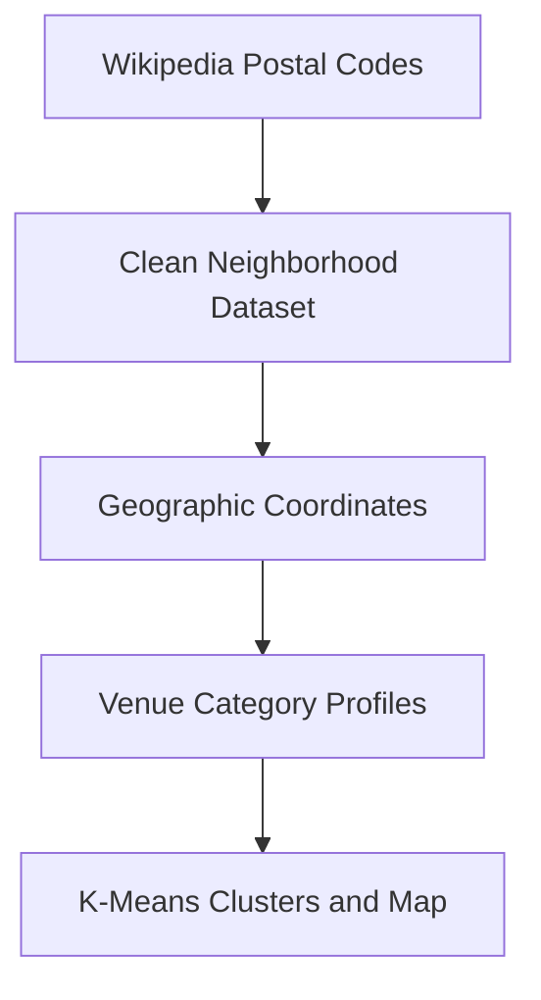

# Toronto Neighborhood Segmentation & Clustering

## Geospatial Data Preparation & Venue-Based Analysis

**A data science portfolio project for organizing Toronto neighborhoods and identifying local patterns through geographic and venue data.**

This project prepares Toronto postal-code and neighborhood data, enriches it with geographic coordinates and nearby venue categories, and applies K-means clustering to create an interpretable neighborhood segmentation.

**Built by Braulio · Academic Portfolio Project · Public and Third-Party Data**  
**Project Date: February 2021**

---

## Business Problem

Urban planning, relocation, and location-selection decisions require more than a list of neighborhood names. Decision-makers need clean geographic data and a structured way to compare the services and venues surrounding different areas.

This analysis addresses four practical questions:

- How can Toronto postal-code data be converted into a clean neighborhood dataset?
- Where is each neighborhood geographically located?
- Which venue categories characterize each area?
- Which neighborhoods exhibit similar local patterns?

---

## Delivered Capabilities

- Extraction of Toronto postal-code, borough, and neighborhood data
- Removal and correction of unassigned geographic records
- Consolidation of multiple neighborhoods sharing a postal code
- Integration of latitude and longitude coordinates
- Filtering of boroughs associated with Toronto
- Nearby-venue retrieval through the Foursquare API
- Venue-category encoding and neighborhood-level aggregation
- Ranking of the ten most common venue categories
- Five-cluster K-means neighborhood segmentation
- Interactive cluster visualization with Folium

---

## Analytical Workflow



---

## Methodology

1. Extract the Toronto postal-code table from Wikipedia.
2. Remove records without an assigned borough.
3. Consolidate neighborhoods that share the same postal code.
4. Replace missing neighborhood names with the corresponding borough.
5. Merge the cleaned records with latitude and longitude data.
6. Retrieve nearby venue categories for Toronto neighborhoods.
7. One-hot encode and aggregate the venue-category data.
8. Rank common venue types and segment neighborhoods into five clusters.
9. Display the clusters on an interactive Toronto map.

---

## Quick Start

### 1. Clone the Repository

```powershell
git clone https://github.com/enzosafadi/FinalProject_City-of-Toronto.git
cd FinalProject_City-of-Toronto
```

### 2. Create and Activate a Virtual Environment

```powershell
py -m venv .venv
.\.venv\Scripts\Activate.ps1
```

### 3. Install the Analytical Packages

```powershell
python -m pip install jupyter pandas numpy requests beautifulsoup4 lxml scikit-learn folium geopy matplotlib
```

### 4. Open the Notebooks

```powershell
jupyter notebook
```

Historical API settings, local file paths, and external data-source URLs must be updated before rerunning every notebook cell.

---

## Technology Stack

| Component | Purpose |
|---|---|
| Python | Data preparation and analysis |
| Jupyter Notebook | Interactive analytical workflow |
| Pandas and NumPy | Data cleaning and feature preparation |
| Requests and Beautiful Soup | Wikipedia table extraction |
| Scikit-Learn | K-means clustering |
| Folium | Interactive neighborhood mapping |
| GeoPy | Geographic lookup support |
| Foursquare API | Historical nearby-venue data |

---

## Project Structure

```text
FinalProject_City-of-Toronto/
├── Segmenting-and-Clustering-Neighborhoods-in-Toronto(1).ipynb
├── Segmenting and Clustering Neighborhoods inToronto(2).ipynb
├── Segmenting-and-Clustering-Neighborhoods-in-Toronto(3).ipynb
└── README.md
```

The three notebooks document successive stages of data preparation, geographic enrichment, venue analysis, clustering, and visualization.

---

## Controls & Limitations

- This is a historical academic analysis, not a live urban-planning application.
- Wikipedia tables, coordinate files, venue APIs, and their schemas may have changed since 2021.
- The notebooks contain legacy local paths and API configuration that require modernization.
- External credentials should be supplied through secure local configuration before reuse.
- Venue categories do not capture every factor relevant to neighborhood quality or suitability.
- The five-cluster selection is a demonstration of segmentation, not a validated business recommendation.

---

## Production Roadmap

1. Consolidate the three notebooks into one reproducible analysis pipeline.
2. Replace legacy data calls and secure all external configuration.
3. Add dependency management, data validation, and automated tests.
4. Expand the model with housing, transit, demographic, safety, and economic data.
5. Publish an interactive neighborhood-comparison application.

---

## Portfolio Context

This repository demonstrates web-data extraction, data cleaning, geographic integration, feature engineering, unsupervised learning, and interactive mapping. It is presented as an academic portfolio project rather than a production decision system.

---

**February 2021 · Academic Portfolio Project · Built by Braulio**
